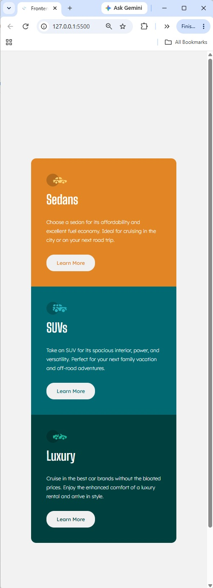

# Frontend Mentor - Stats preview card component solution

This is a solution to the [Stats preview card component challenge on Frontend Mentor](https://www.frontendmentor.io/challenges/stats-preview-card-component-8JqbgoU62). Frontend Mentor challenges help you improve your coding skills by building realistic projects. 

## Table of contents

- [Overview](#overview)
  - [The challenge](#the-challenge)
  - [Screenshot](#screenshot)
  - [Links](#links)
- [My process](#my-process)
  - [Built with](#built-with)
  - [What I learned](#what-i-learned)
  - [AI Collaboration](#ai-collaboration)

## Overview

### The challenge

Users should be able to:

- View the optimal layout depending on their device's screen size

### Screenshot

### Links

- Solution URL: [https://github.com/Acemeistre/FEM_3-column-preview-card-component]
- Live Site URL: [https://acemeistre.github.io/FEM_3-column-preview-card-component/]

## My process

### Built with

- Semantic HTML5 markup
- CSS custom properties
- Flexbox
- CSS Grid

### What I learned

- What are you most proud of, and what would you do differently next time?
First time incorporating a full step by step process of each update that was pushed through git to GitHub.

- What challenges did you encounter, and how did you overcome them?
button was unwantedly changing position relative to the bottom of the card based of width of the viewport.
Instead of individual cards handling the padding I gave cards a shared class - multi-classing is best pratice moving forward.

- What specific areas of your project would you like help with?
Uncertain.

### AI Collaboration

- Tools used - Claude.
- Used for - debugging and brainstorming solutions.
